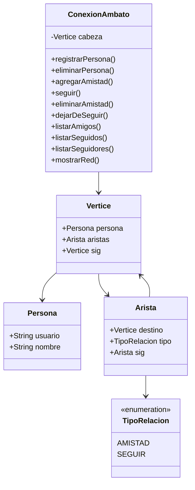

# APE4_Fase2_representacion_dinamica_y_operaciones
# APE 4 – Fase 2: Conexión Ambato

## 1. Descripción del proyecto

Conexión Ambato es una red social dinámica desarrollada en Java mediante una estructura de grafos implementada con multilistas y nodos propios.

El proyecto permite representar usuarios y administrar sus relaciones de amistad y seguimiento, aplicando operaciones de inserción, eliminación y consulta sobre una estructura dinámica.

## 2. Objetivo general

Implementar la evolución de Conexión Ambato desde el grafo estático de la Fase 1 hacia una red social dinámica, mediante listas de adyacencia con nodos propios y operaciones sobre usuarios y relaciones.

## 3. Objetivos específicos

- Representar personas y relaciones de AMISTAD y SEGUIR mediante una multilista.
- Implementar operaciones de registro y eliminación de usuarios.
- Agregar y eliminar relaciones de amistad y seguimiento.
- Validar las operaciones rechazando lazos, duplicados y usuarios inexistentes.
- Comprobar el funcionamiento mediante pruebas automatizadas.
- Analizar el costo temporal de las operaciones.

## 4. Estructura del proyecto

```text
ConexionAmbato_Fase2/
│
├── rsc/
│
├── src/
│   ├── app/
│   │   ├── Main.java
│   │   └── PruebasConexionAmbato.java
│   │
│   ├── modelo/
│   │   ├── Persona.java
│   │   ├── Vertice.java
│   │   └── Arista.java
│   │
│   ├── enums/
│   │   └── TipoRelacion.java
│   │
│   └── negocio/
│       └── ConexionAmbato.java
│
└── README.md
```

## 5. Descripción de los paquetes

### app
Contiene las clases encargadas de ejecutar el programa y realizar las pruebas.

- **Main.java:** permite ejecutar las operaciones del sistema mediante la consola.
- **PruebasConexionAmbato.java:** verifica el funcionamiento de las operaciones mediante pruebas automatizadas.

### modelo
Contiene las clases que representan los elementos de la estructura.

- **Persona.java:** almacena la información de cada usuario.
- **Vertice.java:** representa los nodos de la red social.
- **Arista.java:** representa las conexiones entre los usuarios.

### enums
Contiene el tipo de enumeración utilizado para identificar las relaciones.

- **TipoRelacion.java:** define los tipos de relaciones AMISTAD y SEGUIR.

### negocio
Contiene la lógica principal del sistema.

- **ConexionAmbato.java:** administra los usuarios, las relaciones y las operaciones de consulta y modificación de la red.

## 6. Estructura de datos utilizada

Se implementa un grafo dinámico mediante una multilista, utilizando nodos propios.

La estructura está compuesta por:

- Una lista enlazada de vértices que representa a los usuarios.
- Cada vértice mantiene una lista de aristas.
- Las aristas representan las relaciones entre los usuarios.

### Tipos de relaciones

**AMISTAD:** relación recíproca entre dos usuarios. Si una persona es amiga de otra, ambas mantienen la relación.

**SEGUIR:** relación dirigida en la que un usuario puede seguir a otro sin que necesariamente exista reciprocidad.

## 7. Operaciones del sistema

- Registrar personas.
- Eliminar personas y todas sus conexiones.
- Agregar amistades.
- Eliminar amistades.
- Seguir usuarios.
- Dejar de seguir usuarios.
- Listar amigos.
- Listar usuarios seguidos.
- Listar seguidores.
- Contar amistades.
- Mostrar la red social.

## 8. Reglas y restricciones

El sistema debe cumplir las siguientes condiciones:

- No permitir que un usuario se relacione consigo mismo.
- No permitir relaciones duplicadas.
- No aceptar usuarios que no estén registrados.
- Mantener la reciprocidad de las amistades.
- Mantener la dirección de las relaciones de seguimiento.
- Eliminar todas las conexiones asociadas cuando se elimina un usuario.

Para la implementación se utilizan nodos propios, sin emplear:

- HashMap.
- HashSet.
- ArrayList.
- LinkedList.
- Librerías externas de grafos.

## 9. Diagrama de clases



## 10. Pruebas del sistema

Se realizaron pruebas automatizadas para comprobar las operaciones y restricciones de la red social.

**Resultados obtenidos:**

- 42 pruebas ejecutadas.
- 42 pruebas aprobadas.
- 0 pruebas fallidas.

Las pruebas verifican el registro y eliminación de personas, las relaciones de amistad y seguimiento, las consultas y la integridad de la estructura después de eliminar usuarios.

## 11. Tecnologías utilizadas

- Java.
- Visual Studio Code.
- Git.
- GitHub.

## 12. Ejecución del proyecto

### Requisitos

- Tener instalado Java JDK.
- Tener instalado Visual Studio Code.
- Contar con la extensión Extension Pack for Java.

### Compilar

Desde la carpeta principal del proyecto:

```bash
javac -encoding UTF-8 -d out src/modelo/*.java src/enums/*.java src/negocio/*.java src/app/*.java
```

### Ejecutar

```bash
java -cp out app.Main
```

### Ejecutar las pruebas

```bash
java -cp out app.PruebasConexionAmbato
```
